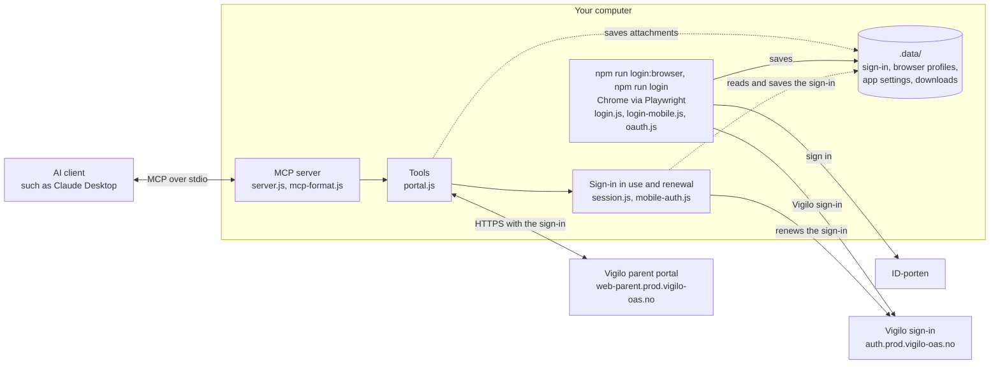

<p align="center"></p>

<h1 align="center">Vigilo MCP</h1>

<p align="center">
  <a href="https://github.com/kristoffervp/vigilo-mcp/actions/workflows/test.yml"></a>
  <a href="https://github.com/kristoffervp/vigilo-mcp/releases"></a>
  <a href="LICENSE"></a>
</p>

<p align="center">English · <a href="README.no.md">Norsk</a></p>

A local MCP server that lets an AI client read Vigilo's parent portal: messages, news, the school schedule, after-school check-ins and message attachments. It only reads, and cannot send messages or change anything in Vigilo.

**Unofficial.** Not made by or affiliated with Vigilo AS, the school or the municipality. It uses undocumented endpoints that can change without notice.

## Quick start

You need Node.js 20 or later and Google Chrome. Sign-in is tested on macOS.

```sh
git clone https://github.com/kristoffervp/vigilo-mcp.git
cd vigilo-mcp
npm install
npm run login:browser
```

`npm run login:browser` opens Chrome for the ID-porten sign-in, and `npm test` checks the server without using your account. Then add the server to your AI client as a local (stdio) server. For Claude Desktop, in `claude_desktop_config.json`:

```json
{
  "mcpServers": {
    "vigilo": {
      "command": "node",
      "args": ["/full/path/to/vigilo-mcp/src/server.js"]
    }
  }
}
```

## Tools

| Tool | What it does |
| --- | --- |
| `list_children` | Your children and their school and after-school units |
| `list_message_threads` | Message threads for one child, after-school units included unless `include_after_school` is `false`. Filters: `from_date`, `to_date` |
| `get_message_thread` | One thread with its messages, without changing the read status |
| `list_news` | News posts for one child. Filters: `from_date`, `to_date` |
| `get_after_school_status` | The latest registered SFO/AKS check-in or check-out for one child on a `date` |
| `get_schedule` | Lessons and calendar events for the week that contains `date` |
| `get_message_attachment` | Saves a message attachment in `.data/downloads/` and returns the path |

Start with `list_children`. The other tools take a child's `id` as `child_id`, and `get_schedule` can take a school unit's `id` as `school_unit_id`. Without it, the child's first school unit is used.

Threads and news cover the last 90 days up to tomorrow, unless you set `from_date` and `to_date` (`YYYY-MM-DD`, at most 366 days apart). `date` defaults to today in Norway. Lists return at most 50 entries, with `total` and `truncated`, and a thread shows its last 50 messages. Text longer than 20,000 characters is cut and marked `textTruncated`. Results are returned as `structuredContent` and as JSON text.

`get_after_school_status` returns `checked_in`, `checked_out` or `unknown`, with the time of the latest registration. It shows what staff registered in Vigilo, which can differ from where the child is.

`get_message_attachment` accepts files up to 10 MB and returns only the path, type and size, so the client must be able to read local files to open it. Types other than PDF, JPEG, PNG, plain text and Word (`.docx`) are saved with `.bin`.

## Renewable sign-in (optional)

The server renews the browser sign-in in headless Chrome for as long as Vigilo's web session allows. After that, run `npm run login:browser` again.

`npm run login` makes a sign-in that renews itself with a refresh token, like the Vigilo app. It needs a private `.data/mobile-client.json` with the app's OAuth settings (`clientId`, `clientSecret`, `redirectUri`, `authority`), which is not included. Never publish this file or use someone else's.

- When `.data/mobile-session.json` exists, the server uses it instead of the browser sign-in.
- A file lock stops two processes from renewing at the same time (`lockf` on macOS, `flock` on Linux).
- The server also runs on Linux with a renewable sign-in made on another computer. Copy `mobile-client.json` and `mobile-session.json` to `.data/`. A renewal can replace the refresh token, so use the copy on one computer only.

## How it works

The server runs on your computer and talks to the AI client over stdio. It uses the renewable sign-in if there is one, and otherwise the browser sign-in, both saved in `.data/`. `mcp-format.js` marks every result as untrusted content from Vigilo and keeps error messages generic.



## Configuration

Set these in the client config (and in Terminal for the login commands):

| Variable | Default | Purpose |
| --- | --- | --- |
| `VIGILO_DATA_DIR` | `.data` in this folder | Sign-in, browser profiles, app settings and downloads |
| `VIGILO_BROWSER_CHANNEL` | `chrome` | Browser for signing in and for renewing the browser sign-in |
| `VIGILO_AUTH_DEBUG` | off | `1` makes `npm run login` print the hosts the sign-in passes through |

## Troubleshooting

- **"Vigilo-innloggingen må fornyes".** The sign-in is missing or has expired. Run `npm run login:browser` again, or `npm run login` if you use the renewable sign-in.
- **"Vigilos appoppsett mangler" or "er ufullstendig".** `npm run login` needs a complete `.data/mobile-client.json`. Use `npm run login:browser` instead.
- **"Innloggingen tok mer enn ti minutter".** Sign-in must finish within ten minutes. Choose your affiliation and open **Foreldreportal** if asked. The window closes when the portal has loaded.
- **"Playwright mangler".** Run `npm install` in the project folder.
- **The client can't start the server.** Use full paths for both `node` (from `command -v node`) and `src/server.js`.
- **"Ugyldige argumenter til Vigilo-verktøyet".** An ID or a date has the wrong format. Use IDs from `list_children` and dates as `YYYY-MM-DD`.
- **"Vigilo-svaret er for stort".** Use a shorter date range. Attachments over 10 MB are refused.
- **"Vigilo-kallet kunne ikke fullføres".** Other errors are not shown in detail. Check the network and the IDs, and try again.

## Security and privacy

- The server runs on your computer and opens no network port. Any AI client you connect can still read what the tools return, and a cloud AI service receives what the client reads. Decide what you are willing to share.
- Only selected fields from Vigilo are passed on, marked as data and not instructions. That can't stop every attempt to steer the AI through a message. Use clients you trust and review tool calls.
- Error messages don't repeat Vigilo's responses or the content of local files.
- `.data/` holds your sign-in and browser profiles, readable only by your user. Never share it. Attachments stay there until you delete them, and the paths returned to the client can include your user name.
- To report a vulnerability, see [SECURITY.md](SECURITY.md).

## Changelog

See [CHANGELOG.md](CHANGELOG.md) and [Releases](https://github.com/kristoffervp/vigilo-mcp/releases).

## License

[0BSD](LICENSE): use, change and share it freely, also commercially, without attribution. It does not cover the Vigilo service or its data.
