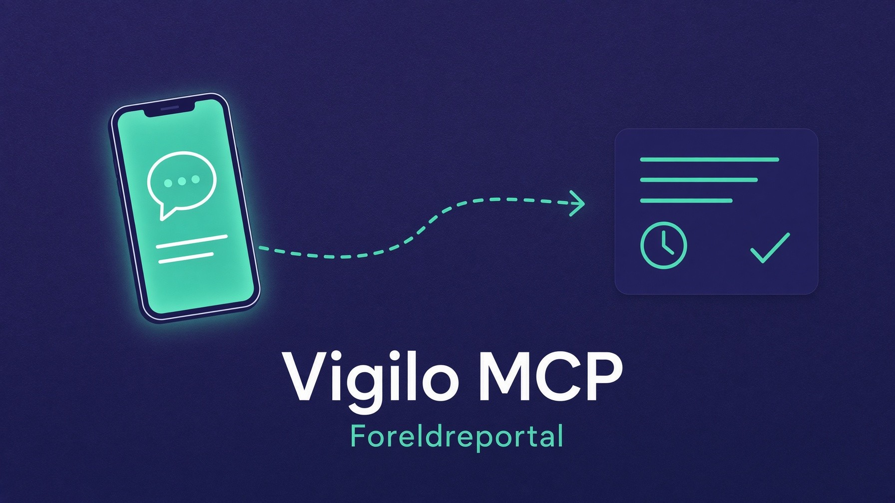
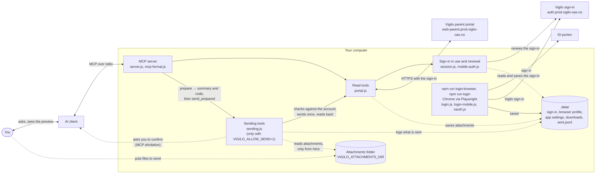

<p align="center"></p>

<h1 align="center">Vigilo MCP</h1>

<p align="center">
  <a href="https://github.com/kristoffervp/vigilo-mcp/actions/workflows/test.yml"></a>
  <a href="https://github.com/kristoffervp/vigilo-mcp/releases"></a>
  <a href="LICENSE"></a>
</p>

<p align="center">English · <a href="README.no.md">Norsk</a></p>

A local MCP server that lets an AI client read Vigilo's parent portal: messages, news, the school schedule, after-school check-ins and message attachments. By default it only reads. Replying, absence reports, check-out notes, meeting bookings and sign-ups are opt-in (see [Sending](#sending-opt-in)).

**Unofficial.** Not made by or affiliated with Vigilo AS, the school or the municipality. It uses undocumented endpoints that can change without notice.

## Quick start

You need Node.js 20 or later and Google Chrome. Sign-in is tested on macOS.

```sh
git clone https://github.com/kristoffervp/vigilo-mcp.git
cd vigilo-mcp
npm install
npm run login:browser
```

`npm run login:browser` opens Chrome for the ID-porten sign-in, and `npm test` checks the server without using your account. Then add the server to your AI client as a local (stdio) server. For Claude Desktop, in `claude_desktop_config.json`:

```json
{
  "mcpServers": {
    "vigilo": {
      "command": "node",
      "args": ["/full/path/to/vigilo-mcp/src/server.js"]
    }
  }
}
```

## Tools

| Tool | What it does |
| --- | --- |
| `list_children` | Your children and their school and after-school units |
| `list_message_threads` | Message threads for one child, after-school units included unless `include_after_school` is `false`. Filters: `from_date`, `to_date` |
| `get_message_thread` | One thread with its messages, without changing the read status |
| `list_news` | News posts for one child. Filters: `from_date`, `to_date` |
| `get_after_school_status` | SFO/AKS check-ins and check-outs for one child on a `date`, with times |
| `get_schedule` | Lessons and calendar events for the week that contains `date` |
| `get_message_attachment` | Saves a message attachment in `.data/downloads/` and returns the path |
| `list_contacts` | Staff you can write to about a child at a unit, with contact teachers |
| `list_absences` | Registered absences at school and AKS/SFO, with whether they can be edited or deleted |
| `list_absence_codes` | The absence codes a unit uses |
| `list_checkout_notes` | AKS/SFO check-out notes ("hentemeldinger"): who picks up, when, or that the child walks home. Default four weeks from today |
| `list_checkout_note_types` | The kinds of check-out note the AKS/SFO offers |
| `list_meeting_invitations` | Meeting invitations, such as a parent-teacher meeting, with free times |
| `list_registrations` | Sign-ups ("påmeldinger") with their choices, deadline and your answer |
| `list_required_actions` | What Vigilo asks parents to do (such as health information), and unread counts per child |
| `list_consent_forms` | Consent forms at a unit, with each guardian's status: `pending`, `given` or `revoked`. Give or revoke consent in Vigilo |

Start with `list_children`. The other tools take a child's `id` as `child_id`, and `get_schedule` can take a school unit's `id` as `school_unit_id`. Without it, the child's first school unit is used.

Threads and news cover the last 90 days up to tomorrow, unless you set `from_date` and `to_date` (`YYYY-MM-DD`, at most 366 days apart). `date` defaults to today in Norway. Lists return at most 50 entries, with `total` and `truncated`, and a thread shows its last 50 messages. Text longer than 20,000 characters is cut and marked `textTruncated`. Results are returned as `structuredContent` and as JSON text.

`get_after_school_status` returns `checked_in`, `checked_out` or `unknown`, with the time of the latest registration. `periods` lists each check-in with its check-out, as UTC `time` and Oslo `localTime` (`HH:MM`). A day can have more than one period, for example morning AKS before school and AKS after school. A period still open has `checkOut: null`. It shows what staff registered in Vigilo, which can differ from where the child is.

Vigilo also says who registered each check-in or check-out (staff or a parent). The server leaves the name out. If you need it, an opt-in flag could be added.

`get_message_attachment` accepts files up to 10 MB and returns only the path, type and size, so the client must be able to read local files to open it. Types other than PDF, JPEG, PNG, plain text and Word (`.docx`) are saved with `.bin`.

## Sending (opt-in)

Set `VIGILO_ALLOW_SEND=1` (in `"env"` in the client config) to add these tools. **Not yet tried against the live service:** the requests follow the parent web portal's code, so check the result in Vigilo the first time you use each one.

| Tool | What it does |
| --- | --- |
| `prepare_reply` | A reply in a message thread, optionally with attachments |
| `prepare_message` | A new message to staff from `list_contacts` (at most 10), optionally with attachments |
| `prepare_absence` | An absence report from today or later: to the contact teachers at school (a note is required, attachments optional), or to AKS/SFO |
| `prepare_edit_absence` | New dates for a school absence Vigilo marks as editable |
| `prepare_delete_absence` | Deletes an absence Vigilo marks as deletable |
| `prepare_checkout_note` | A check-out note: a type from `list_checkout_note_types`, a time (quarter hours, at the latest 18:00), weekdays, and optionally weekly. A note (at most 200 characters) is required for types that use one, and not allowed for the others |
| `prepare_edit_checkout_note` | Changes or shortens a check-out note, with the same rules. Every-other-week notes stay every other week. Once a weekly note has started, only `to_date` can change |
| `prepare_delete_checkout_note` | Deletes a check-out note |
| `prepare_book_meeting` | Books a free time in a meeting invitation |
| `prepare_registration_reply` | Answers a sign-up: one choice, one or more, or all in ranked order, before the deadline |
| `send_prepared` | Sends what a prepare tool prepared |
| `mark_thread_read`, `mark_news_read` | Marks a thread or a news post as read, in one step |

Every send takes two steps. A prepare tool checks the request against your account and returns exactly what will be sent, a one-line `summary` and a one-time code. Nothing has been sent at that point. An edit shows before and after. `send_prepared` needs the code and the same `summary`, so your client's approval prompt shows what is sent. It sends once, and the code expires after 10 minutes or when the server stops. An edit is not sent if the note or absence changed after the preview, nor a check-out note or sign-up answer once its deadline has passed. In the dialog every fact comes first, one line each, and the free text comes last; only the free text is shortened. If your client supports confirmation dialogs (MCP elicitation), the server also asks you there before `send_prepared` or a mark tool does anything. Sent, failed and uncertain attempts are logged in `.data/sent.jsonl`.

- Never choose "Always allow" for `send_prepared`, `mark_thread_read` or `mark_news_read` in your client.
- A check-out note decides how your child leaves AKS. Read the preview carefully.
- If Vigilo doesn't answer clearly after a send, it may still have arrived. Check in Vigilo before you try again.
- Parents can't delete sent messages in Vigilo, and a thread or post can't be marked unread again.
- Attachments are off unless `VIGILO_ATTACHMENTS_DIR` names a folder. The tools take names of files directly in it, nothing else: no subfolders, symlinks out of it, hard links or names with line breaks. PDF, PNG or JPEG (checked by content), at most 5 files of 5 MB each and 10 MB in all. Files are read when prepared, and the preview shows each name, size and a short sha256. Use a folder only you write to (not Downloads or a synced folder), and put only files you mean to send there.
- A message can contain text meant to make the AI client send something. Read the preview, and leave sending off when you don't need it. Don't give these tools to an automated client that reads messages on its own.

## Renewable sign-in (optional)

The server renews the browser sign-in in headless Chrome for as long as Vigilo's web session allows. After that, run `npm run login:browser` again.

`npm run login` makes a sign-in that renews itself with a refresh token, like the Vigilo app. It needs a private `.data/mobile-client.json` with the app's OAuth settings (`clientId`, `clientSecret`, `redirectUri`, `authority`), which is not included. Never publish this file or use someone else's. The sign-in opens Chrome with a temporary profile that is deleted afterwards.

- When `.data/mobile-session.json` exists, the server uses it instead of the browser sign-in.
- A lock stops two processes from renewing the same sign-in at the same time (`lockf` on macOS, `flock` on Linux). Renewal therefore does not work on Windows.
- The server also runs on Linux with a renewable sign-in made on another computer. Copy `mobile-client.json` and `mobile-session.json` to `.data/`. A renewal can replace the refresh token, so use the copy on one computer only.

## How it works

The server runs on your computer and talks to the AI client over stdio. It uses the renewable sign-in if there is one, and otherwise the browser sign-in, both saved in `.data/`. `mcp-format.js` marks every result as untrusted content from Vigilo, and only error messages the server wrote itself are shown. Text is stripped of invisible characters that can hide instructions from you but not from the AI.



## Configuration

Set these in the client config (and in Terminal for the login commands):

| Variable | Default | Purpose |
| --- | --- | --- |
| `VIGILO_DATA_DIR` | `.data` in this folder | Sign-in, the browser profile, app settings and downloads |
| `VIGILO_ATTACHMENTS_DIR` | off | Folder the send tools may take attachments from |
| `VIGILO_BROWSER_CHANNEL` | `chrome` | Browser for signing in and for renewing the browser sign-in |
| `VIGILO_AUTH_DEBUG` | off | `1` makes `npm run login` print the hosts the sign-in passes through |

## Troubleshooting

- **"… Kjør npm run login på nytt" (or `login:browser`).** The sign-in is missing, has expired or is unreadable. Run the command the message names.
- **"Vigilos appoppsett mangler" or "er ufullstendig".** `npm run login` needs a complete `.data/mobile-client.json`. Use `npm run login:browser` instead.
- **"Innloggingen tok mer enn ti minutter" or "Innloggingsvinduet ble lukket".** Sign-in must finish within ten minutes, in the window it opens. Choose your affiliation and open **Foreldreportal** if asked. The window closes when the portal has loaded.
- **"Playwright mangler".** Run `npm install` in the project folder.
- **The client can't start the server.** Use full paths for both `node` (from `command -v node`) and `src/server.js`.
- **"Ugyldig …" or "… må være på format YYYY-MM-DD".** The message names the ID or date with the wrong format. Use IDs from `list_children` and dates as `YYYY-MM-DD`.
- **"Vigilo-svaret er for stort".** Use a shorter date range. Attachments over 10 MB are refused.
- **"Kunne ikke kontakte Vigilo…" or "Vigilo-økten er opptatt".** The network is down, or another process is renewing the sign-in. Try again shortly; you don't need to sign in again.
- **"Vigilo-kallet kunne ikke fullføres".** Other errors are not shown in detail. Check the network and the IDs, and try again.

## Security and privacy

- The server runs on your computer and opens no network port. Any AI client you connect can still read what the tools return, and a cloud AI service receives what the client reads. Decide what you are willing to share.
- Only selected fields from Vigilo are passed on, marked as data and not instructions. That can't stop every attempt to steer the AI through a message. Use clients you trust and review tool calls.
- Error messages don't repeat Vigilo's responses or the content of local files. A refused send shows only Vigilo's error code.
- Nothing is sent to Vigilo unless `VIGILO_ALLOW_SEND=1` is set. The server can't tell whether you or the AI approved a send: it asks you in a dialog when the client supports it, and otherwise your client's tool approval is the only check. The mark tools are one step. Attachments come only from `VIGILO_ATTACHMENTS_DIR`. That keeps the AI from sending other files from your computer only as long as it cannot write to that folder itself.
- `.data/` holds your sign-in, readable only by your user. With the browser sign-in it also holds the Chrome profile the server uses to renew it. Never share it. Attachments stay there until you delete them, and the paths returned to the client can include your user name.
- To report a vulnerability, see [SECURITY.md](SECURITY.md).

## Changelog

See [CHANGELOG.md](CHANGELOG.md) and [Releases](https://github.com/kristoffervp/vigilo-mcp/releases).

## License

[0BSD](LICENSE): use, change and share it freely, also commercially, without attribution. It does not cover the Vigilo service or its data.
