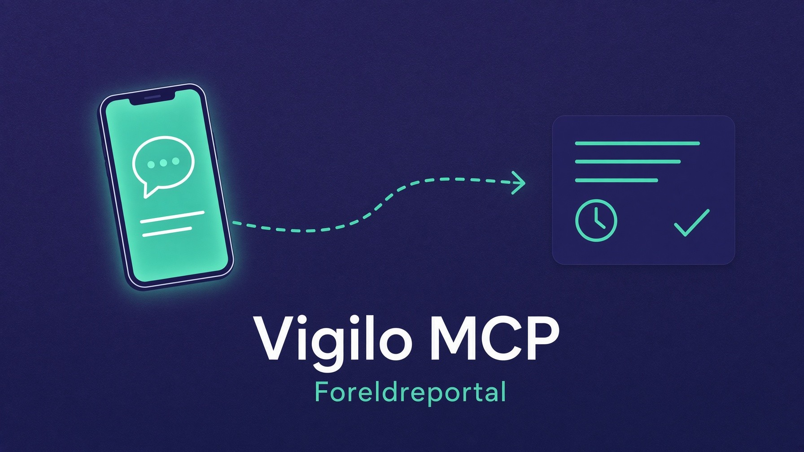
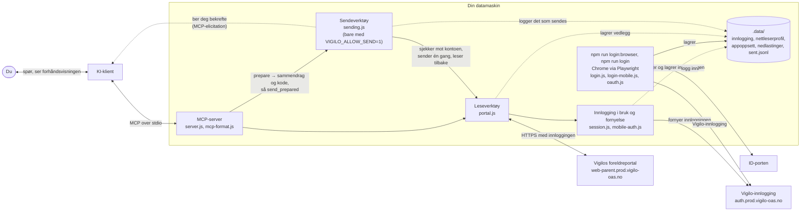

<p align="center"></p>

<h1 align="center">Vigilo MCP</h1>

<p align="center">
  <a href="https://github.com/kristoffervp/vigilo-mcp/actions/workflows/test.yml"></a>
  <a href="https://github.com/kristoffervp/vigilo-mcp/releases"></a>
  <a href="LICENSE"></a>
</p>

<p align="center">Norsk · <a href="README.md">English</a></p>

En lokal MCP-server som lar en KI-klient lese Vigilos foreldreportal: meldinger, oppslag, timeplanen, inn- og utsjekk på AKS/SFO og meldingsvedlegg. Som standard leser den bare. Svar, fraværsmeldinger, hentemeldinger og booking av møter må slås på (se [Sending](#sending-må-slås-på)).

**Uoffisiell.** Ikke laget av eller knyttet til Vigilo AS, skolen eller kommunen. Den bruker udokumenterte endepunkter som kan endres uten varsel.

## Kom i gang

Du trenger Node.js 20 eller nyere og Google Chrome. Innloggingen er testet på macOS.

```sh
git clone https://github.com/kristoffervp/vigilo-mcp.git
cd vigilo-mcp
npm install
npm run login:browser
```

`npm run login:browser` åpner Chrome for innlogging med ID-porten, og `npm test` sjekker serveren uten å bruke kontoen din. Legg så til serveren i KI-klienten som en lokal (stdio) server. For Claude Desktop, i `claude_desktop_config.json`:

```json
{
  "mcpServers": {
    "vigilo": {
      "command": "node",
      "args": ["/full/sti/til/vigilo-mcp/src/server.js"]
    }
  }
}
```

## Verktøy

| Verktøy | Hva det gjør |
| --- | --- |
| `list_children` | Barna dine og skole- og AKS/SFO-enhetene deres |
| `list_message_threads` | Meldingstråder for ett barn, med AKS/SFO med mindre `include_after_school` er `false`. Filtre: `from_date`, `to_date` |
| `get_message_thread` | Én tråd med meldingene, uten å endre lesestatus |
| `list_news` | Oppslag for ett barn. Filtre: `from_date`, `to_date` |
| `get_after_school_status` | Inn- og utsjekk på SFO/AKS for ett barn på en `date`, med klokkeslett |
| `get_schedule` | Skoletimer og kalenderhendelser for uken som inneholder `date` |
| `get_message_attachment` | Lagrer et meldingsvedlegg i `.data/downloads/` og gir stien |
| `list_contacts` | Ansatte du kan skrive til om et barn ved en enhet, med kontaktlærere |
| `list_absences` | Registrert fravær på skole og AKS/SFO, med om det kan slettes |
| `list_absence_codes` | Fraværskodene en enhet bruker |
| `list_checkout_notes` | Hentemeldinger på AKS/SFO: hvem som henter, når, eller at barnet går hjem selv. Standard fire uker fra i dag |
| `list_checkout_note_types` | Typene hentemelding AKS/SFO tilbyr |
| `list_meeting_invitations` | Møteinvitasjoner, for eksempel utviklingssamtale, med ledige tider |

Begynn med `list_children`. De andre verktøyene tar barnets `id` som `child_id`, og `get_schedule` kan ta en skoleenhets `id` som `school_unit_id`. Uten den brukes barnets første skoleenhet.

Tråder og oppslag gjelder de siste 90 dagene fram til i morgen, med mindre du setter `from_date` og `to_date` (`ÅÅÅÅ-MM-DD`, høyst 366 dager mellom). `date` er dagens dato i Norge hvis den ikke er satt. Lister gir høyst 50 elementer, med `total` og `truncated`, og en tråd viser de siste 50 meldingene. Tekst over 20 000 tegn kuttes og merkes `textTruncated`. Svarene kommer som `structuredContent` og som JSON-tekst.

`get_after_school_status` gir `checked_in`, `checked_out` eller `unknown`, med tidspunktet for siste registrering. `periods` viser hver innsjekk med utsjekken som hører til, som UTC-`time` og norsk `localTime` (`HH:MM`). En dag kan ha flere perioder, for eksempel morgen-AKS før skolen og AKS etter skolen. En periode som ikke er avsluttet, har `checkOut: null`. Den viser det personalet har registrert i Vigilo, og det kan avvike fra hvor barnet er.

Vigilo sier også hvem som registrerte inn- eller utsjekken (ansatt eller forelder). Serveren tar ikke med navnet. Trenger du det, kan det legges til et valg for det.

`get_message_attachment` tar filer opptil 10 MB og gir bare sti, type og størrelse, så klienten må kunne lese lokale filer for å åpne den. Andre typer enn PDF, JPEG, PNG, ren tekst og Word (`.docx`) lagres med `.bin`.

## Sending (må slås på)

Sett `VIGILO_ALLOW_SEND=1` (i `"env"` i klientoppsettet) for å få disse verktøyene. **Ikke prøvd mot den ekte tjenesten ennå:** forespørslene følger koden i foreldreportalen, så sjekk resultatet i Vigilo første gang du bruker hvert av dem.

| Verktøy | Hva det gjør |
| --- | --- |
| `prepare_reply` | Et svar i en meldingstråd |
| `prepare_message` | En ny melding til ansatte fra `list_contacts` (høyst 10) |
| `prepare_absence` | En fraværsmelding fra i dag eller senere: til kontaktlærerne på skolen, eller til AKS/SFO |
| `prepare_delete_absence` | Sletter et fravær Vigilo merker som mulig å slette |
| `prepare_checkout_note` | En hentemelding: en type fra `list_checkout_note_types`, et klokkeslett (kvarter, senest 18:00), hverdager, og eventuelt ukentlig |
| `prepare_delete_checkout_note` | Sletter en hentemelding |
| `prepare_book_meeting` | Velger en ledig tid i en møteinvitasjon |
| `send_prepared` | Sender det et prepare-verktøy har forberedt |
| `mark_thread_read` | Merker en tråd som lest, i ett steg |

Alt som sendes, går i to steg. Et prepare-verktøy sjekker forespørselen mot kontoen din og gir nøyaktig det som vil bli sendt, en `summary` på én linje og en engangskode. Da er ingenting sendt. `send_prepared` trenger koden og den samme `summary`, så godkjenningen i klienten viser hva som sendes. Den sender én gang, og koden går ut etter 10 minutter eller når serveren stopper. Støtter klienten bekreftelsesdialoger (MCP elicitation), spør serveren deg også der før `send_prepared` eller `mark_thread_read` gjør noe. Sendte, mislykkede og usikre forsøk logges i `.data/sent.jsonl`.

- Velg aldri «Tillat alltid» for `send_prepared` eller `mark_thread_read` i klienten.
- En hentemelding avgjør hvordan barnet ditt forlater AKS. Les forhåndsvisningen nøye.
- Får du ikke et tydelig svar fra Vigilo etter en sending, kan den likevel ha kommet fram. Sjekk i Vigilo før du prøver igjen.
- Foreldre kan ikke slette sendte meldinger i Vigilo, og en tråd kan ikke merkes som ulest igjen.
- Bare tekst. Vedlegg støttes ikke.
- En melding kan inneholde tekst som skal få KI-klienten til å sende noe. Les forhåndsvisningen, og la sending være av når du ikke trenger den. Ikke gi disse verktøyene til en automatisk klient som leser meldinger på egen hånd.

## Fornybar innlogging (valgfritt)

Serveren fornyer nettleserinnloggingen i Chrome uten vindu så lenge Vigilos nettøkt tillater det. Etter det kjører du `npm run login:browser` på nytt.

`npm run login` lager en innlogging som fornyer seg selv med et fornyelsestoken, slik Vigilo-appen gjør. Den trenger en privat `.data/mobile-client.json` med appens OAuth-oppsett (`clientId`, `clientSecret`, `redirectUri`, `authority`), som ikke følger med. Publiser aldri denne filen, og bruk aldri andres. Innloggingen åpner Chrome med en midlertidig profil som slettes etterpå.

- Når `.data/mobile-session.json` finnes, bruker serveren den i stedet for nettleserinnloggingen.
- En lås hindrer at to prosesser fornyer samme innlogging samtidig (`lockf` på macOS, `flock` på Linux). Derfor virker ikke fornyelsen på Windows.
- Serveren kjører også på Linux med en fornybar innlogging laget på en annen datamaskin. Kopier `mobile-client.json` og `mobile-session.json` til `.data/`. En fornyelse kan bytte ut fornyelsestokenet, så bruk kopien på bare én datamaskin.

## Slik virker det

Serveren kjører på datamaskinen din og snakker med KI-klienten over stdio. Den bruker den fornybare innloggingen hvis den finnes, og ellers nettleserinnloggingen, begge lagret i `.data/`. `mcp-format.js` merker hvert svar som ikke-betrodd innhold fra Vigilo, og bare feilmeldinger serveren selv har skrevet, vises. Usynlige tegn som kan skjule instruksjoner for deg, men ikke for KI-en, fjernes fra teksten.



## Innstillinger

Settes i klientoppsettet (og i Terminal for innloggingskommandoene):

| Variabel | Standard | Brukes til |
| --- | --- | --- |
| `VIGILO_DATA_DIR` | `.data` i denne mappen | Innlogging, nettleserprofilen, appoppsett og nedlastinger |
| `VIGILO_BROWSER_CHANNEL` | `chrome` | Nettleser for innlogging og for fornyelse av nettleserinnloggingen |
| `VIGILO_AUTH_DEBUG` | av | `1` får `npm run login` til å skrive ut vertene innloggingen går gjennom |

## Feilsøking

- **«… Kjør npm run login på nytt» (eller `login:browser`).** Innloggingen mangler, er utløpt eller kan ikke leses. Kjør kommandoen meldingen nevner.
- **«Vigilos appoppsett mangler» eller «er ufullstendig».** `npm run login` trenger en komplett `.data/mobile-client.json`. Bruk `npm run login:browser` i stedet.
- **«Innloggingen tok mer enn ti minutter» eller «Innloggingsvinduet ble lukket».** Innloggingen må fullføres innen ti minutter, i vinduet som åpnes. Velg tilhørighet og åpne **Foreldreportal** hvis du blir bedt om det. Vinduet lukkes når portalen har lastet.
- **«Playwright mangler».** Kjør `npm install` i prosjektmappen.
- **Klienten får ikke startet serveren.** Bruk hele stien til både `node` (fra `command -v node`) og `src/server.js`.
- **«Ugyldig …» eller «… må være på format YYYY-MM-DD».** Meldingen sier hvilken ID eller dato som har feil format. Bruk ID-er fra `list_children` og datoer som `ÅÅÅÅ-MM-DD`.
- **«Vigilo-svaret er for stort».** Bruk en kortere datoperiode. Vedlegg over 10 MB avvises.
- **«Kunne ikke kontakte Vigilo…» eller «Vigilo-økten er opptatt».** Nettet er nede, eller en annen prosess fornyer innloggingen. Prøv igjen om litt; du trenger ikke logge inn på nytt.
- **«Vigilo-kallet kunne ikke fullføres».** Andre feil vises ikke i detalj. Sjekk nettverket og ID-ene, og prøv igjen.

## Sikkerhet og personvern

- Serveren kjører på din datamaskin og åpner ingen nettverksport. En KI-klient du kobler til, kan likevel lese det verktøyene gir, og en KI-tjeneste i skyen får det klienten leser. Vurder selv hva du vil dele.
- Bare utvalgte felt fra Vigilo sendes videre, merket som data og ikke instruksjoner. Det kan ikke stoppe alle forsøk på å styre KI-en gjennom en melding. Bruk klienter du stoler på, og se over verktøykallene.
- Feilmeldinger gjentar ikke Vigilos svar eller innholdet i lokale filer. En avvist sending viser bare feilkoden fra Vigilo.
- Ingenting sendes til Vigilo med mindre `VIGILO_ALLOW_SEND=1` er satt. Serveren kan ikke vite om det var du eller KI-en som godkjente: den spør deg i en dialog når klienten støtter det, ellers er godkjenningen i klienten den eneste sjekken. `mark_thread_read` er ett steg.
- `.data/` inneholder innloggingen din, og kan bare leses av brukeren din. Med nettleserinnloggingen ligger også Chrome-profilen serveren bruker til å fornye den, der. Del den aldri. Vedlegg ligger der til du sletter dem, og stiene klienten får, kan inneholde brukernavnet ditt.
- Se [SECURITY.md](SECURITY.md) for å melde fra om sikkerhetshull.

## Endringslogg

Se [CHANGELOG.no.md](CHANGELOG.no.md) og [Releases](https://github.com/kristoffervp/vigilo-mcp/releases).

## Lisens

[0BSD](LICENSE): bruk, endre og del fritt, også kommersielt, uten krav om kreditering. Lisensen gjelder ikke Vigilo-tjenesten eller innholdet der.
